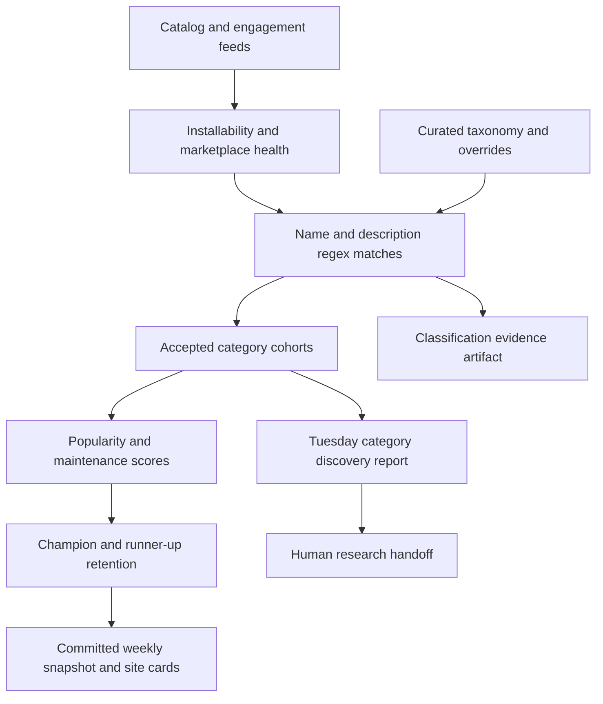

# Categorization and weekly ranking investigation — 2026-10-12

The current pipeline reliably reproduces its rules, but those rules do not reliably establish that a plugin performs a category's task. After qualification, the system ranks whole-plugin popularity and maintenance, without measuring how useful that plugin is for the particular job. Several categories also combine jobs for which the competitors are not substitutes. These three problems explain why a popular plugin can win an inappropriate category.

The clearest current failure is **Syncthing winning Screenshots & Recording**. Its qualifying evidence is the word `screenshot` in a sentence describing its preview image. The Thursday dry run predicted this promotion; Monday published it with all 210 tests passing. This is an observed production error, not a hypothetical edge case.

There is a second substantial issue in selection: the 10% incumbent retention rule operates on a score capped at 1. At the current rescore, 46 of 54 champions score above 1/1.1, so no challenger can beat them by 10% while their score remains that high. Fifteen champions are below their category's current top scorer; four top scorers occupy neither recommendation card. The pages disclose the stability rule, but the headline promise of finding the best plugin for the job deserves a stronger connection to task suitability and the current evidence.

The best improvement is to make **task suitability a separate, inspectable qualification decision**, define categories around comparable outcomes, and use activity scores to order candidates that satisfy that decision. More regex exclusions or different popularity weights alone will not solve the structural problem.

## Scope and evidence

This investigation examined all 54 category rules and all 108 champion/runner-up assignments, replayed classification across the complete captured catalog, inspected recent Actions logs and artifacts, and checked upstream READMEs for 20 relevant repositories. It is a complete pipeline investigation and a catalog-wide automated audit with focused source research. It is not a manual code review or installation test of all 5,416 plugins.

The fixed input is the [October 12 ranking run](https://github.com/BVisagie/omapicks/actions/runs/38256629842), captured at `2026-10-12T13:34:39.901Z`, using code `ab4cb80f3c225b68a4ef56121703e49cbaddc3bb`, classifier 2 and methodology 1.1.0. The published data is commit `e80c04c`, week 2026-W42. Live browser inspection confirmed W42 and Syncthing on [the screenshot category page](https://omapicks.com/picks/screenshots/). Search-engine copies of site pages returned older weeks, so they were not used to determine current winners.

| Measure | Current snapshot |
| --- | ---: |
| Catalog listings | 5,416 |
| Eligible community plugins | 4,349 |
| Unique classified plugins | 2,014 |
| Category assignments | 2,399 |
| Eligible but unclassified | 2,335 — 53.7% of eligible plugins |
| Not installable | 969 |
| Repository unreachable | 45 |
| Compatibility check failed | 15 |
| Built-ins excluded | 38 |
| Assignments explicitly held for review | 0 |

Unclassified is not synonymous with incorrectly excluded: many plugins perform tasks outside the current taxonomy. However, the examples below establish that some clear fits are also being missed.

Downloaded evidence, upstream README bodies/blob hashes, simulation code and logs are available in the ignored workspace directory `tmp/investigation/`. A compact, durable record accompanies this report in [the evidence JSON](categorization-investigation-2026-10-12.json). Raw Actions artifacts expire after 90 days.

## How categorization and ranking actually work

The main files are [the taxonomy](../data/app-types.json), [classification and ranking](../build/rank.mjs), [methodology definitions](../build/methodology.mjs), [refresh](../build/refresh.mjs), [the audit](../build/classification-audit.mjs), and [rendering](../build/render.mjs).



1. General eligibility excludes built-ins, failed/unreachable marketplace checks, retired/delisted listings, missing installation commands and non-HTTPS repository strings. Missing health results do not count as a failure.
2. Each category independently matches `include` against the name and description, and `nameInclude` against the name. Any one positive match can qualify. Tags and upstream categories do not qualify independently, and separate fields are not concatenated into synthetic phrases.
3. Assignment precedence is review hold → explicit exclusion → explicit inclusion → category exclusion → positive match. Category exclusions apply to the whole name/description, so an unrelated negative word can veto an otherwise valid capability.
4. The `task` prose describes intended boundaries for humans; the classifier does not interpret it. A `task-match` decision means a regex matched, not that primary purpose or substantial capability was verified.
5. Multi-category membership is allowed, with no distinction between core functionality, substantial secondary functionality, a tiny convenience control, and a misleading mention once accepted. There are 32 explicit include assignments and 32 explicit exclude assignments. Some retain researched capabilities with URLs; others are catalog-based exceptions. Holds exist as a mechanism but are currently empty.
6. Every accepted cohort is scored separately. The same plugin's global copies, hearts, stars and views are reused in each category. Normalization is relative to the cohort, so incorrect inclusions and omissions also change the scores of valid competitors.
7. Both champion and runner-up retain eligible incumbents unless a challenger scores strictly more than 10% higher. Runner-up selection excludes the champion. Rendering uses the frozen snapshot and its recorded methodology, not live source feeds.

The eligibility separation, auditability, methodology versioning and frozen public snapshot are useful foundations. The weakness is the evidence standard for membership and headline qualification.

## Confirmed incorrect assignments

These eight assignments contradict their category's stated task. The matched fragments come from the captured classification artifact. Repository links provide the upstream capability descriptions used to check the interpretation.

| Plugin | Incorrect category | Accepted evidence | What it actually does |
| --- | --- | --- | --- |
| [Syncthing / Syncshell](https://github.com/omarchy-QOL/syncshell) | Screenshots & Recording, **champion** | `screenshot` in its preview explanation | Folder/device synchronization and a Syncthing interface. A picture of the interface does not establish capture functionality. |
| [Attention](https://github.com/ayandexyz/omarchy-attention) | Screenshots & Recording | `screen capture` in `No screen capture` | Blurs the screen based on head pose. Its explicit denial is interpreted as positive evidence. |
| [Nanit](https://github.com/GruperTal/omarchy-nanit) | Brightness | `night light` | Controls a baby camera's physical night light, not the computer display. |
| [My Network](https://github.com/elliotalien/elliot-network-plugin) | Radio | `radio` in `Multi-radio Wi-Fi panel` | Wi-Fi adapter and connection management. Radio hardware is not streaming audio. |
| [Modem Manager](https://github.com/MariposaJon/omarchy_modemmanager_plugin) | Radio | `radio` in `Cellular radio` | Mobile broadband connectivity, not radio playback. It is also missed by Network. |
| [GoDark](https://github.com/SalimRK/godark) | Radio | `radio` | Disables and restores radio/network links. It is also missed by Network. |
| [Omaplug — Plugin & Package Manager](https://github.com/Pegorim/omaplug) | Music | `manage installed software, check updates, and track` | Software/plugin management. The verb `track` is mistaken for a music track. It is not accepted into Plugin Manager. This is `mateus.omaplug`, distinct from the current `omaplug` champion. |
| [Legion Toolkit](https://github.com/tedwester/omalegion) | Peripheral Batteries | A span connecting `battery panel` to later `keyboard` text | Laptop power/battery and separate keyboard lighting controls. Its computer-battery capability is excluded from Battery because the description also mentions a keyboard. |

The Radio champion remains a clear fit. Errors in lower-ranked members still matter: they distort the cohort, can become future winners, and make the competed count overstate meaningful alternatives.

The Syncthing failure illustrates a complete missed correction cycle:

- [October 8 midweek check](https://github.com/BVisagie/omapicks/actions/runs/37785897318): predicts Syncthing replacing Omashot, with scores 0.985229 versus 0.870746.
- [October 12 weekly refresh](https://github.com/BVisagie/omapicks/actions/runs/38256629842): publishes Syncthing at 0.980847; the other champion change is Firewall, Snitch → Omawall.
- The current page explains the screenshot result using copies and stars, but gives no category-specific explanation of capture capability.
- Tuesday discovery's broad-overlap queue does not include Syncthing: a wrong single-category assignment can pass through it unnoticed.

## Clear fits that are being missed

| Plugin | Missing category | Evidence and cause |
| --- | --- | --- |
| [Spotlight](https://github.com/maajix/omarchy-spotlight) | Launcher | Its description calls it a Raycast-style launcher and says it launches applications. The regex recognizes different word forms/phrases. It is accepted for Clipboard, Network, Brightness and Calendar, and is Clipboard champion and Brightness runner-up. |
| [OmaSpotify](https://github.com/jeremylanger/omaspotify) | Music | The name's compound `OmaSpotify` does not match the standalone name term; the compact description says Spotify in Quickshell without a recognized playback phrase. The README documents transport and a full player. It has 1,098 copies but is entirely unclassified. |
| [Omapager](https://github.com/ryanrhughes/omapager) | Notifications | The captured description establishes a replacement notification service with stacking, grouping, reply and snooze. Its word order misses the patterns. The README documents a daemon, history and DND. Entirely unclassified, with 786 copies. |
| [OmaControl](https://github.com/Davedes83/OmaControl) | System Monitor | The description explicitly says task manager and historical resource monitoring, but those forms miss the rules. The README documents resource graphs and per-process inspection. Entirely unclassified, with 482 copies. |
| [Omaplug](https://github.com/Pegorim/omaplug) | Plugin Manager | `Plugin and package manager` and `discover plugins` miss the accepted adjacent nouns and verbs, while the Music false match accepts it. |
| [Legion Toolkit](https://github.com/tedwester/omalegion) | Battery | Laptop charge controls are described directly. A global exclusion for `keyboard` defeats them. |

Additional catalog leads include application docks, Omaland's visual configuration panel, window minimization tools, notification rules, file synchronization and backup utilities. They require task/source review before inclusion or new categories; their popularity alone is not justification.

Together, the errors show why repeatedly extending keyword lists is insufficient. Negation, verb/noun ambiguity, nearby unrelated features, compound names and paraphrases all affect decisions even when the underlying capability is clear. Broad exclusions can suppress genuine multipurpose tools just as broad inclusions can over-admit them.

## Categories that need clearer jobs, even when the capabilities are real

These are category design and recommendation questions, not blanket accusations that the plugins are incorrectly described.

| Current category | Current comparison problem | Better decision for the user |
| --- | --- | --- |
| Brightness | Lacquer wins and Spotlight is runner-up through real night-light controls. That does not establish the best display luminosity control. | Separate Screen Brightness from Night Light, under a display-controls parent. Show settings-suite convenience as context. |
| Network | Vitals wins, Argus is runner-up, and OmaStats is raw-score leader. Resource monitors and Wi-Fi connection managers serve different requests. | Separate Connection Management from Traffic & Diagnostics. |
| Music | MPRIS controls, full music clients, lyrics tools and phone media controls compete together. OmaConnect's media capability is real but phone integration carries its general engagement. | At least distinguish Media Controls from Music Players; state local/remote scope and provider requirements. |
| Radio | TekTube's song-seeded YouTube Music radio is runner-up among live-station players. Its README describes starting a mix from the current song. | Define whether the job is live internet stations or generated music mixes; use separate treatment if both are useful. |
| Screenshots & Recording | Capture, existing screenshot management, OCR window search and recording status/stop controls coexist. Dynamic Island only exposes Omarchy's recorder activity and stop control; OmaSwitch OCR searches window contents. | Define capture/annotation, recording and OCR extraction outcomes. Status integrations belong as related tools unless they meet the chosen capture contract. |
| Clock & Timer | Omodoro and a world-clock tool are the two recommendations. | Clocks & Time Zones and Timers & Alarms are different tasks; Pomodoro can also qualify for Focus. |
| AI Assistant | Session browser/orchestrator headlines cover a category that also claims chat/model controls. | Separate Agent Sessions from AI Chat & Models. |
| Containers | Local runtime tracing and a remote read-only Proxmox dashboard are compared. | State runtime, host scope and read-only/control capabilities; split only when there are useful cohorts. |
| Peripheral Batteries | Nothing Audio is device-specific; Mouse & Keybind Settings has a secondary battery indicator. | Show supported devices and offer a general battery-monitoring choice where evidence supports it. |
| Workspaces / Window Management | Overview, indicators and selection/configuration tools can solve different navigation needs. | Task labels and capability descriptions should precede the activity comparison. |

Spotlight's clipboard search is a real function, and X-Ray's documented container/process inspection is a real cross-category capability. A rule that only specialist plugins may qualify would throw away useful recommendations. A substantial, directly usable secondary capability can be excellent. The required distinction is between a completed user task and incidental technology, a thin integration, or incomplete scope; primary purpose is useful evidence, not an automatic monopoly on eligibility.

Hardware-, account- and provider-specific choices need visible constraints. A high-scoring Nothing-device or Proton-only integration cannot be an unconditional best choice for someone using different hardware or a different VPN. These constraints need not all create separate categories.

## What the popularity score can and cannot select

Methodology 1.1.0 uses these weights:

| Signal | Weight |
| --- | ---: |
| Install-command copies | 36% |
| Hearts | 20% |
| GitHub stars | 18% |
| Detail-page views | 3% |
| Copy/view Wilson lower bound | 5% |
| Repository push freshness | 13% |
| Verification coverage | 5% |

Counts are logged, normalized with a 70% cohort percentile / 30% robust scale blend, and damped toward the midpoint for sparse engagement. Freshness has a 180-day half-life. Copy/view values are capped and unrated below 20 views. These are reasonable public-activity heuristics; copies are not measured installations, and none of these signals measures task completeness, workflow quality or category-specific adoption.

Two effects follow:

- A popular suite can carry unrelated adoption into every accepted secondary category. It is impossible to infer from the aggregate counters that people installed Lacquer for night light or OmaConnect for media controls.
- Correct and incorrect cohorts set the normalization distribution. A metadata wording change can affect both membership and everyone's score, even when engagement does not change.

Keep activity scoring as supporting evidence among task-qualified competitors. If fit is decisive, encode it as a qualification rule or explicit fit tier rather than a tiny weighted bonus that popularity can overwhelm. Do not claim a numeric semantic-confidence value is a calibrated probability without evaluation.

### Retention is stronger than the copy suggests

The selection test is `challenger.score > incumbent.score * 1.1`. Since a score cannot exceed 1, an incumbent at or above 0.909091 cannot be displaced at that rescore. This does not mean it is permanently invincible: its later normalized score may fall or it may lose eligibility. It does mean the current threshold is unattainable for 46 current champions.

Fifteen of 54 champions trail the raw-score leader. Examples are Alt-tab switcher versus Exposé (5.67% difference), Session Browser versus Agent Orchestrator (6.36%), and Theme Manager versus Themes Gallery (4.05%). System Monitor, Network, Workspaces and AI & API Usage each have a raw-score leader in neither card. The site does disclose these leaders in explanatory text; users cannot compare them as a normal recommendation card.

In a fixed-input simulation using the same prior snapshot, taxonomy, time and feeds:

| Retention threshold | Changed champions versus current rules | Changed runner-ups |
| --- | ---: | ---: |
| 10% | 0 | 0 |
| 3% | 5 | 9 |
| 0% | 15 | 29 |

This is sensitivity analysis, not evidence that 3% is optimal. Any percentage margin on a capped score has the same ceiling problem. Prefer showing the current top task-qualified candidate as champion, with weekly freezing providing publication stability. If continuity matters, show the previous pick separately or require a repeated lead across observations. Runner-up should normally be the strongest eligible alternative rather than a second sticky historical slot. Assess turnover over replayable historical inputs before activating a new selection method.

## How the GitHub Actions work

| Workflow | Nominal schedule | Permissions and outcome |
| --- | --- | --- |
| [Weekly rankings](../.github/workflows/weekly-rank.yml) | Monday 06:17 UTC; manual dispatch | `contents: write`; fetches feeds, refreshes data, archives classification evidence, runs Node tests and production render, then commits/pushes changed data directly to the default branch. No category research or semantic winner gate. |
| [Weekly category discovery](../.github/workflows/category-discovery.yml) | Tuesday 06:43 UTC; manual dispatch | `contents: read`, `actions: read`; tests safeguards, restores prior successful main-branch observations, scans feeds and optional explorer graph, writes a research report and state artifacts. No model call, taxonomy edit, PR or publication. |
| [Midweek ranking check](../.github/workflows/midweek-check.yml) | Thursday 06:17 UTC; manual dispatch | `contents: read`; live `--dry-run` classification/ranking and archived evidence, then tests/build of committed data. Predictions do not publish or become adjudicated decisions. |
| [CI](../.github/workflows/ci.yml) | Push and pull request | Tests, production render and Playwright browser checks. It checks expected behavior and presentation, without reviewing the purpose of live winners. |

Weekly/midweek runs share `ranking-refresh` concurrency and do not cancel running jobs. Discovery has separate per-ref concurrency. Weekly and midweek time out after 15 minutes; discovery and CI after 10. Actions are pinned to commit hashes. Classification and discovery artifacts are retained for 90 days.

### Freeze and publication behavior

An ordinary refresh skips feed fetching and recalculation if the current ISO week, taxonomy hash and classifier version already match. A taxonomy or classifier change can bypass this freeze. A methodology-only change does not: it requires the next week or an explicit `--republish`. A dry run still fetches and calculates, while leaving published files unchanged. A deliberate same-week republish retains earlier weekly changelog events.

The weekly job runs its own tests and build before pushing. A push made with the default `GITHUB_TOKEN` does not trigger another push workflow, so the separate CI workflow is not a second browser-test gate for the bot's snapshot commit. This follows [GitHub's workflow-trigger behavior](https://docs.github.com/en/actions/how-tos/write-workflows/choose-when-workflows-run/trigger-a-workflow). The weekly job itself does not run Playwright. There is no deployment job in the checked-in workflows; the production W42 browser check confirms deployment occurred, but the hosting integration was not inspected.

Cron is not an exact publication guarantee. Recent scheduled runs were created at October 5 14:50 UTC, October 6 13:34 UTC and October 8 13:38 UTC, hours after their nominal schedules. October 12's inspected ranking run was manually dispatched at 13:34 UTC. GitHub documents that [scheduled runs can be delayed or dropped under load](https://docs.github.com/en/actions/reference/workflows-and-actions/events-that-trigger-workflows#schedule). Monitor snapshot age and failed/missing runs instead of promising an exact Monday publication time.

### Feed safeguards

The refresh validates catalog IDs, stats schema/counts, at least 50% catalog/stats overlap and at least 75% of the previous stats entry count. It excludes current failed/unreachable listings and records source checksums. Preview failures do not invent replacement metadata. The retirement registry is optional and labels departures rather than selecting winners.

There is an asymmetry: weekly refresh requires an absolute minimum of 1,000 catalog listings, while discovery also preserves at least 75% of the prior catalog count. With this captured input, a hypothetical 1,500-listing catalog plus the complete stats feed passes weekly validation despite dropping 72% of the catalog. That is a tested safeguard gap, not a claim that a truncated feed occurred. Use relative catalog preservation and a clear override path for legitimate bulk removals. Apply the existing streamed response-size bound to weekly catalog/stats fetches too; currently they use plain `fetchJson` while discovery uses `boundedFetch`.

## What Tuesday discovery is currently adding

The [October 6 discovery run](https://github.com/BVisagie/omapicks/actions/runs/37471848521) produced a reproducible report with two previous comparable observations, 127 retained candidate groups and 105 `ready-for-probe` groups. Its three highlighted probes are `claude-code`, `coding-agent` and `coding-agents`.

Those represent closely related vocabulary without necessarily representing the same task: the samples span account switching, status monitoring, orchestration, chat, MCP management and protective controls. The singular/plural groups even have disjoint prominent repository sets in this artifact, so repository-set deduplication cannot solve the semantic redundancy. All three visible slots are nevertheless consumed by the AI topic. Useful security-scanning and other task leads remain deeper in the JSON. `ready-for-probe` establishes repeated lexical evidence, not a defensible category.

The scanner requires three prominent unclassified repositories across two owners and recurrence 6–21 days later. It scans curated concepts and repeated two-word phrases, retains the first observation per ISO week, resets incompatible history, and suppresses recorded decisions until three new prominent repositories appear. Explorer neighbours and cluster gaps supply lexical research leads only. These safeguards appropriately keep discovery from directly editing the taxonomy.

Its membership review queue flags plugins in three or more categories or explicit holds. The October 6 queue contains 35 plugins, and current catalog replay contains 39 with three or more assignments. That detects broad suites, but misses wrong one-category winners and two-category mistakes. Discovery also focuses on unclassified gaps: a misclassified file-sync plugin can appear covered even though its actual job is missing. No file-sync/Syncthing probe is among the retained October 6 candidates.

Improve the report's allocation of review attention: headline changes and weak-purpose matches first, then high-value omissions in existing categories, then possible new tasks. Merge semantic topic duplicates before choosing the three highlighted probes, and report review outcomes and queue age. The documented four-week evaluation should assess useful fixes and review effort, rather than the number of repeated phrases.

## Recommended implementation sequence

### 1. Correct known assignments and create an evaluation corpus

Use per-assignment exclusions/holds for the confirmed errors, and source-backed inclusions for clear missed capabilities. Review the entire affected cohorts, especially the next screenshot candidates, rather than swapping one inappropriate winner for another. Add positive and negative fixtures for preview references, negation, radio hardware, physical lighting, verb/noun ambiguity, primary-purpose misses and independent computer/peripheral battery clauses.

Build an editorially labelled set that distinguishes core purpose, substantial secondary task, thin integration, incidental mention and uncertainty. Include winners, top challengers, random members and plausible omissions. Evaluate precision and recall by category and headline qualification. A passing deterministic test suite currently establishes consistency with encoded expectations; it does not establish classification accuracy on new prose.

### 2. Define each category's task contract before selecting its winner

Record the user outcome, minimum capabilities, important boundaries and relevant constraints. Test whether two candidates are practical substitutes for someone with that goal. Start with the categories in the design table above. Keep parent categories/navigation when splitting to avoid an unwieldy homepage, and use capability labels for small niches that do not justify a separate ranking.

Separate **discoverable category membership** from **qualification for its champion/runner-up cards**. A recording indicator or a shortcut into the built-in clipboard can be useful related software without making it the best capture tool or clipboard manager. A multipurpose suite with complete native task controls can qualify normally.

### 3. Store adjudicated capability evidence

Keep regexes and explorer similarity for candidate discovery. Store a deterministic, versioned decision for ambiguous and headline-relevant assignments, with plugin ID, category/task version, capability scope, source URL, source revision or content hash, evidence location, rationale, review date and decision provenance. Revisit decisions when the relevant metadata or source capability changes. An inclusion override with an old prose reason should not remain permanently authoritative after the underlying feature changes.

A possible assignment record is:

```json
{
  "pluginId": "example.capture",
  "categoryId": "screen-capture",
  "contractVersion": 1,
  "decision": "qualified",
  "role": "substantial-secondary",
  "capabilities": ["region-capture", "save-image", "annotation"],
  "constraints": ["requires-existing-capture-backend"],
  "sourceUrl": "https://github.com/example/capture#features",
  "sourceRevision": "record-the-inspected-revision",
  "reviewedAt": "2026-10-12",
  "reason": "Direct user-operated capture and export, checked against this task contract."
}
```

This can be a curated data file and an ordinary review process; it does not require a runtime model. If LLM assistance is added, run it on captured new/changed evidence and proposed headlines, require supporting sources and inspect counterexamples, and store reviewable proposed decisions. Published rankings should replay from committed decisions without depending on a fresh model answer. Upstream prose must remain research input, not instructions to the reviewer or authorization to execute plugin code.

### 4. Make the weekly workflow close the review loop

Add a task-qualification report/gate before snapshot publication. Rank only assignments satisfying the current headline contract; uncertain candidates should enter the existing per-assignment hold mechanism. Make new or materially changed headline qualifications prominent in the artifact and assign review responsibility. A reviewed unchanged capability should not require repeated manual approval every week.

Thursday should surface proposed winner/runner-up changes with the exact task evidence and constraints, and feed a durable review queue that Monday consumes. Tuesday remains useful for new-category research, but it runs after the Monday publication it cannot validate in advance. A queued review, its resolution and the evidence revision should be visible rather than inferred from a green workflow.

Retain reproducible input capture, source health checks, failure isolation and frozen snapshots. Strengthen relative feed guards and run-age visibility. Changing classification semantics requires a classifier version change; changing scoring/selection or headline eligibility rules requires a new immutable methodology definition. Taxonomy edits already invalidate the same-week freeze, so deliberate publication behavior needs to be documented with the rollout.

### 5. Improve selection and the explanation visitors receive

After task qualification, evaluate removing champion hysteresis and runner-up stickiness, or replace them with a persistence rule that can actually be met near the score ceiling. Keep the raw-score leader available as a comparison card when continuity retains an older pick.

Each recommendation should explain why it fits this job, what task scope it covers, the main requirement or limitation, and then why the public-activity evidence ranks it highly. Examples would be a standalone region-capture tool versus a recorder status integration, or computer brightness versus night-light scheduling. Expose meaningful alternatives within the category rather than only two historically sticky slots. A category-specific score explanation should not imply that more global copies establish better task performance.

## Fixed-input correction experiments

The simulation first reproduced all 54 published categories' counts, pick identities, pick scores and raw-score leaders exactly. It then removed only the eight confirmed assignments listed above, retaining the same feeds, time, scoring method and prior snapshot.

| Affected cohort | Candidate count before → after | Headline result when replaying Monday from W41 incumbents |
| --- | --- | --- |
| Screenshots & Recording | 39 → 37 | Syncthing → Omashot; OmaSwiss retained |
| Brightness | 38 → 37 | Same picks; changed normalization/scores |
| Radio | 35 → 32 | Same picks; changed normalization/scores |
| Music | 127 → 126 | Same picks; changed normalization/scores |
| Peripheral Batteries | 55 → 54 | Same picks; changed normalization/scores |

If the same correction is applied *after* publication using W42 incumbents, the screenshot champion becomes **Dynamic Island**, not Omashot: removing Syncthing creates a vacancy filled by the highest remaining score. Its source documents recording activity plus a stop control, illustrating why headline task qualification must accompany the correction. The simulation does not recommend either result without evaluating the complete capture contract.

A separate experiment added the source-verified OmaSpotify/Music, Omapager/Notifications and OmaControl/System Monitor assignments on top of those corrections. None changed those three categories' headline identities under the current retention rule. That does not make the omissions harmless: the competitors and normalized distributions change, while the existing selection policy keeps the slots.

This report describes the pre-change baseline and the investigation phase, which changed only the report and its supporting evidence record. The subsequent implementation is documented in [methodology 1.2.0](methodology-1.2.0.md).

## Reproduction and validation

The current workspace contains the exact downloads and research script:

```sh
gh run download 38256629842 --name classification-audit --dir tmp/investigation/current
gh run download 37471848521 --name category-discovery-report --dir tmp/investigation/discovery
npm ci
npm run audit:classification -- --input tmp/investigation/current/inputs.json --output tmp/investigation/replay
node scripts/category-discovery.mjs --input tmp/investigation/discovery/inputs.json --output tmp/investigation/discovery-replay
node tmp/investigation/analyze.mjs
npm test
npm run build
```

At the investigation revision, classification and discovery report JSON replays matched their original artifacts exactly. The sensitivity experiments cloned the captured taxonomy/methodology in memory and wrote only ignored research files. All 210 Node tests passed, and the production render succeeded. The production category was inspected through the shared browser. To replay discovery algorithm 4, use the workflow commit recorded in its capture; current discovery uses algorithm 5. Implementation validation is recorded separately in the subsequent PR.
